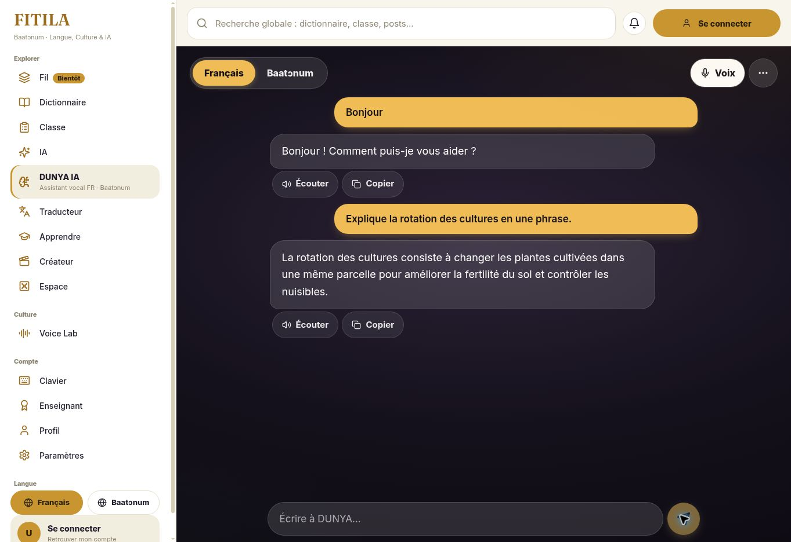
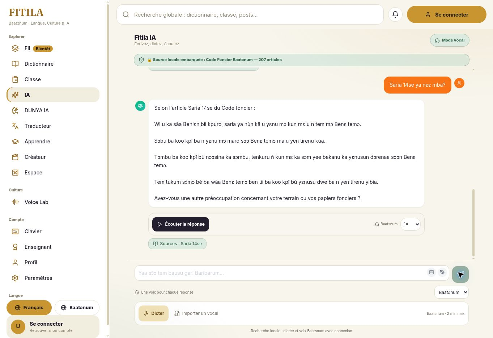

# FITILA — bilan et correctifs du 26 octobre 2026

Le web et les serveurs sont déployés. L’APK de production **1.8.25+36**, publication **v1.8.25-build36-241**, est disponible sur [fitila.bj/install](https://fitila.bj/install). Publication : **26 octobre 2026 à 01:43:35**, heure du Bénin (Africa/Lagos, UTC+1).

## Corrections livrées

| Demande | Résultat |
| --- | --- |
| Français DUNYA en ligne | Erreur HTTP 503 corrigée dans la sérialisation de l’historique du serveur Gemma. Le même échange avec historique renvoie HTTP 200 ; deux tours ont été vérifiés dans l’interface web. |
| Dictée française Android | Reconnaisseur natif fr-FR, résultats partiels, annulation et protection contre les anciens callbacks ; repli sur le moteur existant si le service Android est absent. |
| Bariba hors ligne malgré les packs installés | Activation du pack ByT5 lors de la première demande explicite ; désactivation ultérieure respectée. Correction de l’incompatibilité native ONNX et protection des classes JNI dans l’APK optimisé. Sessions et cache conservés entre les tours. |
| Option « les deux langues » | Retirée du web et de Flutter. Français et Baatɔnum uniquement ; ancien choix « les deux » interprété comme français. |
| FITILA IA sur Flutter | Remplacé par TEM et la recherche du Code foncier, en texte et en vocal. Les 207 articles sont identiques au web. |
| Recherche foncière | Classement web/Flutter aligné. Un numéro explicite renvoie l’article complet et sa seule source ; Saria 14se vérifié dans le navigateur. Aucun contenu juridique généré ajouté au corpus. |
| STT bariba et stabilité | Capture des voix faibles, silence initial raccourci avec préservation du début des mots, pause de fin plus tolérante, annulation des anciens tours. Serveur CPU en FP32, threads et concurrence bornés. |
| Réponse trop lente | Réponses vocales plus courtes, traduction rapide, cache limité aux réponses générées, réutilisation des sessions locales. TEM interroge directement les articles embarqués. Une publication web ne redémarre plus les moteurs vocaux. |

## Mesures et vérifications

- **297 tests Flutter**, analyse du code, régressions natives et clavier sur émulateur réussis dans le pipeline 40247728176. Les contrôles de code identique ont été réutilisés pour la reconstruction portant sur R8 ; la signature et le contrôle des APK finaux ont été exécutés sur la publication 241.
- **Vrais modèles sur Android, réseau coupé : succès** dans le job 121332763487. Reconnaissance locale du fichier français du pack, traduction ByT5 français → bariba puis synthèse MMS bariba, avec Wi-Fi et données mobiles désactivés. Le pack cerveau conversationnel général n’est pas inclus dans cet essai.
- **APK ARM64 et ARMv7 : succès** du contrôle ELF, de la conservation de 12 classes référencées par JNI dans le mapping R8 et le DEX, de la signature et des empreintes sur le serveur.
- **Vérification HTTPS publique : succès** dans le pipeline 40250416053 : deux APK HTTP 200, tailles vérifiées, requêtes partielles HTTP 206, en-têtes ZIP valides, fichier SHA-256 concordant et page d’installation HTTP 200.
- Français avec historique : **503 avant → 200 après** ; contrôle après correction à 5 339 ms côté serveur.
- Essai vocal synthétique : **33 829 → 19 371 ms côté serveur**, soit **42,7 % de réduction** ; environ **23,7 s côté client**. Un seul essai comparable, sans garantie de latence générale ni certification linguistique.
- Corpus web/Flutter : même empreinte SHA-256, 207 articles et cinq cas de parité. Interface publique contrôlée pour les deux langues, la conversation française et l’article exact.
- Serveurs : pipeline 40241887751 réussi. Fonctions Supabase actives : fitila-ia-chat v21 et dunya-voice-turn v19. Dernière publication web réussie : 40250416057.

Le blocage natif a été reproduit dans l’ancien APK : JNI exigeait VERS_1.22.0 tandis que le cœur exportait VERS_1.28.2. Sherpa et ses paquets natifs sont maintenant épinglés à 1.13.4, avec la liaison Java ONNX 1.27.0 ; les deux APK exportent et utilisent VERS_1.27.0. La règle de conservation JNI suit la [documentation officielle ONNX](https://onnxruntime.ai/docs/build/android.html).

## Reprendre sur le téléphone

1. Installer la publication **v1.8.25-build36-241** depuis la page d’installation.
2. Ouvrir DUNYA, choisir **Baatɔnum**, puis **Hors ligne**. Les packs déjà installés sont réutilisés ; le premier essai explicite active le traducteur bêta.
3. Vérifier que le pack voix et le pack ByT5 sont installés. Le cerveau local reste nécessaire aux réponses générales élaborées ; TEM utilise ses articles embarqués.
4. Ouvrir la rubrique **IA** pour retrouver le Code foncier en modes écrit et vocal.

## Limites et maintenance restante

La traduction ByT5 conserve son statut **bêta non certifiée**. Sur trois courts extraits bariba exécutés uniquement en local, le modèle ASR publié produit une transcription mais présente encore 72,2 % d’erreurs de mots et 19,5 % d’erreurs de caractères. Ce petit contrôle n’est pas un benchmark indépendant : la stabilité technique améliorée ne suffit pas à rendre la reconnaissance bariba fiable dans toutes les situations. La qualité linguistique reste à travailler.

Aucun téléphone physique de l’utilisateur n’a été utilisé. La voix française hors ligne dépend d’une voix système française installée ; aucune voix nécessitant Internet n’est forcée en mode hors ligne.

Le secret GitHub **SUPABASE_ACCESS_TOKEN reste invalide (401)**. Les fonctions actuelles ont été publiées avec succès via le connecteur ; les prochains déploiements automatiques Supabase nécessitent le renouvellement de ce secret. Aucun appel payant Mistral ou Gemini n’a été ajouté.

Le contrôle d’approbation automatique a refusé un test distant sur des voix humaines, faute d’autorisation explicite pour ce transfert vers Supabase. Le test n’a pas été relancé et ses résultats n’ont pas servi à la validation ; les contrôles ont continué avec de la synthèse et de l’inférence locale.

## Preuves

- [Données de vérification](dunya-tem-build36/verification.json)
- [Compilation et validation de la publication 241](https://github.com/starlab007007/bariba-lex-builder/actions/runs/40249956320)
- [Contrôle HTTPS public](https://github.com/starlab007007/bariba-lex-builder/actions/runs/40250416053)

