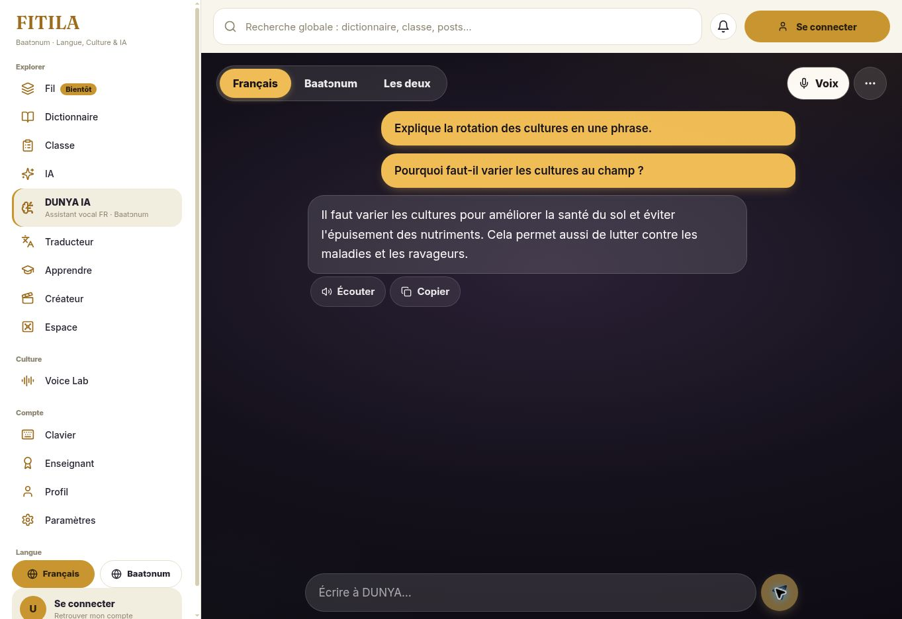
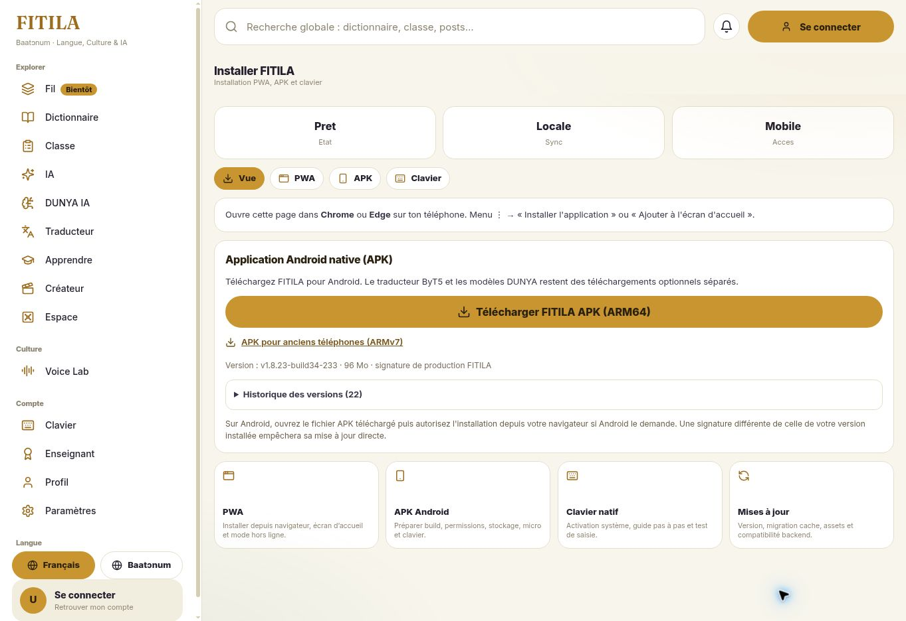

# FITILA — finalisation du 25 octobre 2026

## Résultat vérifié en production

Le web fonctionne sur https://fitila.bj. La révision `5a2e31d1e8cbdb5852a9b42454db498380d37e62` a été activée le 25 octobre à **20:42:41 UTC / 21:42:41 au Bénin** par [le workflow web](https://github.com/starlab007007/bariba-lex-builder/actions/runs/40231912859).

- DUNYA utilise maintenant Gemma 4 E2B sur le VPS FITILA, sans appel à un fournisseur payant. Le modèle est isolé dans le réseau Docker, protégé par le jeton serveur existant ; aucune nouvelle clé n'est exposée au navigateur.
- La fonction `fitila-ia-chat` v20 joint la passerelle authentifiée `/voice-api/chat`. La variable historique pointait vers `/api/meta-voice`, qui ne sert que l'inférence vocale et renvoyait HTTP 405 pour le chat.
- Une question agricole en français a produit une réponse HTTP 200 avec `provider: fitila-local`, `model: gemma-4-e2b`. Le parcours DUNYA complet a émis `transcript`, `answer`, `done` en 3,902 s côté serveur, environ 9,26 s depuis le client de contrôle. La réponse a également été vérifiée visuellement dans le site public.
- Un cycle avec une salutation synthétisée en baatɔnum a exécuté Omnilingual ASR, ByT5, Gemma et MMS TTS, puis émis un audio et `done` en 33,829 s côté serveur. Ce contrôle valide le raccordement technique, pas la justesse linguistique : l'ASR a transcrit imparfaitement la salutation et la réponse a demandé une clarification.
- La passerelle vocale corrige l'abandon des résultats textuels `list[str]` d'Omnilingual. L'initialisation des modèles précède désormais leur échauffement. `bariba-stt` v12 mesure réellement la latence et conserve les métadonnées du moteur.
- `dunya-voice-turn` v18 distingue les indisponibilités du cerveau et les erreurs de traduction.

Le [déploiement des services VPS](https://github.com/starlab007007/bariba-lex-builder/actions/runs/40228830362) a réussi avec des inférences réelles TTS → ASR et Gemma, pas uniquement un contrôle de disponibilité HTTP.

## Flutter et Android

La version construite et signée est **1.8.23+34**. Le mode IA en ligne utilise le même moteur privé que le web ; il ne nécessite pas le téléchargement du modèle sur le téléphone. Le mode automatique conserve son repli local.

La traduction ByT5 hors ligne non certifiée nécessite maintenant une activation expérimentale explicite, désactivée par défaut. Retirer ce consentement désactive le moteur et invalide les réponses hors ligne déjà en cache. Quatre tests de politique et un test de révocation du cache couvrent ce comportement.

[La construction Android](https://github.com/starlab007007/bariba-lex-builder/actions/runs/40229833072) a réussi l’analyse Flutter, les 288 tests Flutter, les tests natifs, le parcours clavier réel sur émulateur, la construction des deux APK et la vérification de signature. Sa dernière étape de miroir GitHub privé a été refusée HTTP 403 ; la publication sur fitila.bj a réussi à partir du même artefact immuable, sans reconstruction ni nouvelle signature.

La [publication contrôlée](https://github.com/starlab007007/bariba-lex-builder/actions/runs/40231644208) est en ligne depuis **20:38:07 UTC / 21:38:07 au Bénin**, version publique `v1.8.23-build34-233` : ARM64 100 312 031 octets, ARMv7 58 940 941 octets. Les deux URL répondent HTTP 200 et proposent des APK signés avec le certificat de production. Page de téléchargement : https://fitila.bj/install.

La page d’installation est corrigée pour rafraîchir son manifeste : le service worker le conservait dans le cache des modèles pendant un an. Les manifestes JSON passent désormais par le réseau ; le manifeste Android porte un en-tête sans cache et une nouvelle requête évite les anciennes entrées PWA.

Empreinte SHA-256 du certificat de production : `931f901a227199fe867845b2ededf122fe858ffc2c82900f82675e4a541a4b67`.

## Audios pédagogiques

Quatre enregistrements Apprendre déjà approuvés, de qualité 100, avec consentement valide et texte courant, ont été activés avec la fonction de publication existante. Les quatre apparaissent dans le manifeste public ; leurs URL signées et leurs fichiers audio répondent HTTP 200 anonymement.

Les 766 références Classe approuvées et courantes possèdent toutes leur objet de stockage. L'audit HTTP anonyme a réussi pour **766/766 fichiers** : création d'une URL signée puis téléchargement d'un segment audio non vide. Les chemins contenant des espaces ont été encodés avant leur vérification. Les cinq références audio de cours génériques possèdent également leur objet.

## Qualité hors ligne : bêta maintenue

Le pack public V4 INT8 et ses trois modèles passent les contrôles d'intégrité. L'exécution réelle de 100 exemples par direction sur CPU, avec les largeurs de faisceau Android, donne :

| Direction | chrF++ | Boucles détectées | Moyenne CPU |
|---|---:|---:|---:|
| français → baatɔnum | 29,51 | 0 % | 1,523 s |
| baatɔnum → français | 25,19 | 2 % | 1,461 s |

Ces scores sont sous le seuil de certification de 45. Le jeu historique peut recouper les données d'entraînement ou la mémoire : ce n'est pas une évaluation indépendante. Aucun test physique Android en mode avion n'a été réalisé. Aucune certification n'a été ajoutée. Voir [les résultats reproductibles](offline-int8-20261025.json) et `scripts/dunya_translate/audit_published_pack.py`.

## Validation et intervention restante

- [Validation IA](https://github.com/starlab007007/bariba-lex-builder/actions/runs/40230903481) : 106 tests réussis, 0 échec ; contrôles navigateur réussis.
- 11 tests ciblés de chat local, 6 tests HTTP de la passerelle Gemma, 5 tests de transcription et d'initialisation vocale réussis.
- [Pipeline traduction](https://github.com/starlab007007/bariba-lex-builder/actions/runs/40230204924) réussi.
- Le déploiement automatique Supabase vérifie maintenant strictement les types, les tests et l'authentification. Le secret GitHub Actions `SUPABASE_ACCESS_TOKEN` est rejeté HTTP 401. Les fonctions nécessaires ont été déployées avec succès via l'accès Supabase connecté ; les futurs déploiements automatiques restent bloqués jusqu'au remplacement sécurisé du secret.

Pour rétablir l'automatisation : créer un jeton Supabase valide limité au projet FITILA et à l'écriture des Edge Functions, remplacer le secret `SUPABASE_ACCESS_TOKEN` dans l'environnement GitHub Actions `production`, puis relancer « Deploy FITILA voice & translation functions ». Ne pas transmettre ce jeton dans un message, un ticket ou un fichier du dépôt.

La certification hors ligne exige encore une amélioration mesurée du modèle, une évaluation indépendante et une validation sur téléphone physique en mode avion.
